<h1 align="center">Cześć, tu Darek 👋</h1>

<b>Inteligentny dom · Home Assistant · narzędzia i skrypty</b> 
Tworzę karty i integracje do Home Assistanta, a także narzędzia, skrypty i małe programy do codziennej pracy. Po polsku i po angielsku, ustawiane klikając, bez YAML.

  
  
  
  
  
  
  
  
  

##  Moje projekty

<table>
<tr>
<td width="200" align="center"></td>
<td>

### [Okno HA](https://github.com/superdarco78/roleta-realistyczna)

Realistyczne okno z roletą (dzień-noc, plisa, żaluzja i inne). Przesuwasz ją palcem, animacja jest zsynchronizowana z silnikiem, a za szybą widać pogodę i porę dnia. Kreator ustawia kartę za Ciebie, bez YAML.

</td>
</tr>
</table>

<table>
<tr><td align="center" valign="top" width="25%"> <a href="https://github.com/superdarco78/roleta-realistyczna#wyglad-w-roznych-sytuacjach"> <b>Pogoda</b> Deszcz, śnieg, słońce albo noc za oknem</a></td><td align="center" valign="top" width="25%"> <a href="https://github.com/superdarco78/roleta-realistyczna#akcje-jak-sterowac"> <b>Sterowanie palcem</b> Przesuń w górę albo w dół</a></td><td align="center" valign="top" width="25%"> <a href="https://github.com/superdarco78/roleta-realistyczna#krok-4"> <b>Kreator</b> Sam znajdzie Twoje urządzenia</a></td><td align="center" valign="top" width="25%"> <a href="https://github.com/superdarco78/roleta-realistyczna#okno-i-kontaktrony"> <b>Otwarte okno</b> Pokazuje okno otwarte i uchylone</a></td></tr>
<tr><td align="center" valign="top" width="25%"> <a href="https://github.com/superdarco78/roleta-realistyczna#ruch-i-kalibracja"> <b>Prędkość silnika</b> Rusza się tak szybko jak silnik</a></td><td align="center" valign="top" width="25%"> <a href="https://github.com/superdarco78/roleta-realistyczna#kolory-i-okleiny"> <b>Kolory</b> Dąb, orzech, antracyt i inne</a></td><td align="center" valign="top" width="25%"> <a href="https://github.com/superdarco78/roleta-realistyczna#wyglad"> <b>Jasny i ciemny</b> Pasuje do motywu Home Assistant</a></td><td align="center" valign="top" width="25%"> <a href="https://github.com/superdarco78/roleta-realistyczna#tlumaczenia"> <b>Polski i angielski</b> Język z Twojego profilu</a></td></tr>
</table>

  <a href="https://github.com/superdarco78/roleta-realistyczna"><picture><source media="(prefers-color-scheme: dark)" srcset="https://raw.githubusercontent.com/superdarco78/roleta-realistyczna/main/img/z3/stany/dzien.png"></picture></a>
  <a href="https://github.com/superdarco78/roleta-realistyczna"><picture><source media="(prefers-color-scheme: dark)" srcset="https://raw.githubusercontent.com/superdarco78/roleta-realistyczna/main/img/z3/stany/burza.png"></picture></a>
  <a href="https://github.com/superdarco78/roleta-realistyczna"><picture><source media="(prefers-color-scheme: dark)" srcset="https://raw.githubusercontent.com/superdarco78/roleta-realistyczna/main/img/z3/stany/okno.png"></picture></a>
  <a href="https://github.com/superdarco78/roleta-realistyczna"><picture><source media="(prefers-color-scheme: dark)" srcset="https://raw.githubusercontent.com/superdarco78/roleta-realistyczna/main/img/z3/stany/noc.png"></picture></a>

<picture><source media="(prefers-color-scheme: dark)" srcset="https://raw.githubusercontent.com/superdarco78/roleta-realistyczna/main/img/z3/animacja-ciemna.webp"></picture>

  

  

##  Na czym pracuję

- 🪟 Okna i rolety: kolejne wersje karty Okno HA (zasłony, markizy)
- 🌍 Każda karta mówi po polsku i po angielsku. Język wybiera się sam.
- 🪄 Kreator krok po kroku w każdej karcie. Ustawienie zajmuje minutę.

##  Statystyki

  
  

---

🇬🇧 Hi, I'm Darek. I build Home Assistant cards and integrations, plus tools and scripts for everyday work. Set up by clicking, no YAML.

