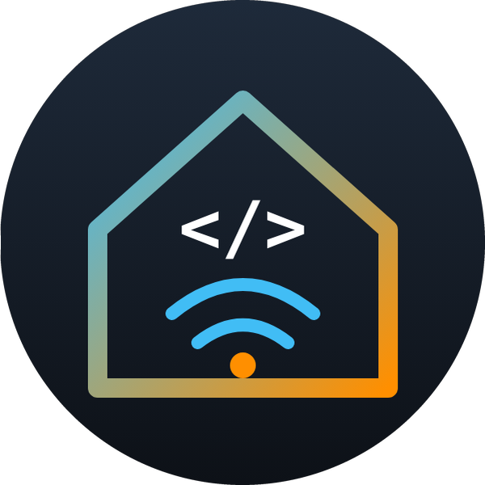

<h1 align="center">Cześć, tu Darek 👋</h1>

<b>Home Assistant · karty Lovelace · inteligentny dom</b> 
Robię karty do Home Assistanta, które wyglądają jak prawdziwe rzeczy w domu i dają się ustawić klikając, bez YAML.

  
  
  
  
  
  
  
  
  

## 🏠 Moje karty do Home Assistanta

<table>
<tr>
<td width="200" align="center"></td>
<td>

### [Roleta dzień-noc](https://github.com/superdarco78/roleta-realistyczna)

Roleta dzień-noc (zebra) na oknie jak prawdziwa. Przesuwasz ją palcem, animacja jest zsynchronizowana z silnikiem, a za szybą widać pogodę i porę dnia. Kreator ustawia kartę za Ciebie, bez YAML.

</td>
</tr>
</table>

| 🪄 Kreator | 🔍 Sama wykrywa | 👆 Palcem | ⏱ 1:1 z silnikiem | 🌦 Pogoda | 🌅 Pora dnia | 🌍 PL / EN |
|:---:|:---:|:---:|:---:|:---:|:---:|:---:|
| 3 kroki, bez YAML | rolety, silnik, kontaktrony | uchwyty, STOP | kalibracja 1 klik | deszcz, burza, śnieg | dzień, zachód, noc | wg języka HA |

  <a href="https://github.com/superdarco78/roleta-realistyczna"><picture><source media="(prefers-color-scheme: dark)" srcset="https://raw.githubusercontent.com/superdarco78/roleta-realistyczna/main/img/stany/dzien.png"></picture></a>
  <a href="https://github.com/superdarco78/roleta-realistyczna"><picture><source media="(prefers-color-scheme: dark)" srcset="https://raw.githubusercontent.com/superdarco78/roleta-realistyczna/main/img/stany/burza.png"></picture></a>
  <a href="https://github.com/superdarco78/roleta-realistyczna"><picture><source media="(prefers-color-scheme: dark)" srcset="https://raw.githubusercontent.com/superdarco78/roleta-realistyczna/main/img/stany/okno.png"></picture></a>
  <a href="https://github.com/superdarco78/roleta-realistyczna"><picture><source media="(prefers-color-scheme: dark)" srcset="https://raw.githubusercontent.com/superdarco78/roleta-realistyczna/main/img/stany/noc.png"></picture></a>

<picture><source media="(prefers-color-scheme: dark)" srcset="https://raw.githubusercontent.com/superdarco78/roleta-realistyczna/main/img/animacja-ciemna.gif"></picture>

  

  

## 🛠 Na czym pracuję

- 🪟 Okna i rolety: kolejne wersje rolety dzień-noc
- 🌍 Każda karta mówi po polsku i po angielsku. Język wybiera się sam.
- 🪄 Kreator krok po kroku w każdej karcie. Ustawienie zajmuje minutę.

## 📈 Statystyki

  
  

---

🇬🇧 Hi, I'm Darek. I make Home Assistant Lovelace cards that look like real things at home and are set up by clicking, no YAML.

